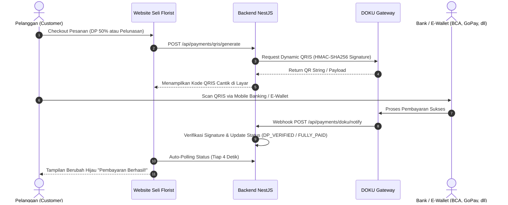

# 💳 Panduan Integrasi Pembayaran Custom QRIS DOKU — Seli Florist

Dokumen ini menjelaskan langkah-langkah menghubungkan akun merchant **DOKU** Anda ke sistem website Seli Florist agar pelanggan dapat membayar langsung menggunakan **QRIS Dinamis** (tanpa perlu unggah bukti transfer manual).

---

## 📍 Langkah 1: Ambil Kredensial di DOKU Dashboard

Anda saat ini sedang berada di halaman:  
👉 **`https://dashboard.doku.com/bo/integrations`**

Salin 2 data penting berikut dari halaman tersebut:

1. **Client ID** (atau Merchant ID):
   * Berupa string ID unik toko Anda (contoh: `MALLID-XXXX` atau kode ID numerik).
2. **Secret Key** (Shared Key):
   * Klik tombol **View / Salin** (biasanya memerlukan verifikasi OTP via email/SMS).
   * Rahasiakan kunci ini dan jangan dibagikan ke publik.

---

## ⚙️ Langkah 2: Status Kredensial di File `.env` Backend

Kredensial Sandbox DOKU Anda telah berhasil dikonfigurasi di [`backend/.env`](file:///Users/agustinaseli/Documents/RickyPrakusa/Selly-Store/backend/.env):

```env
# DOKU Payment Gateway (Sandbox Mode Aktif)
DOKU_CLIENT_ID=BRN-0216-1791393259285
DOKU_SECRET_KEY=SK-GK9h3hCQPoBrgC8EqBp4
DOKU_API_KEY=doku_key_sandbox_b517562bfdaf47c29eff2ba85cc49db5
DOKU_IS_PRODUCTION=false
DOKU_NOTIFICATION_URL=http://localhost:3000/api/payments/doku/notify
```

> **Catatan Mode:**
> * `DOKU_IS_PRODUCTION=false` (Mode Sandbox aktif untuk pengujian aman).
> * Jika di masa depan akun Anda sudah disetujui untuk Live Production, cukup ganti kredensial dengan Production Key dan ubah `DOKU_IS_PRODUCTION=true`.

---

## 🔔 Langkah 3: Pengaturan Notification URL (Webhook) di DOKU

Agar DOKU dapat memberi tahu website Anda saat pelanggan berhasil scan dan membayar QRIS:

1. Di dashboard DOKU, buka menu **Settings** > **Payment Settings** atau tab **Notifications** di halaman Integrations.
2. Masukkan URL Notification:
   * **Untuk Server Live / Domain Production:**  
     `https://domain-anda.com/api/payments/doku/notify`
   * **Untuk Pengujian Lokal (Localhost):**  
     Gunakan tunnel seperti ngrok (`https://xxxx.ngrok-free.app/api/payments/doku/notify`) atau gunakan fitur bawaan **Auto-Polling / Tombol Simulasi** di halaman pesanan.
3. Pilih metode notifikasi: **HTTP POST (JSON)**.

---

## 🔄 Bagaimana Alur Transaksi QRIS Bekerja?



---

## ✨ Fitur Custom QRIS di Website Seli Florist

1. **Komponen Visual Custom di Halaman Pesanan ([`frontend/components/qris-payment-box.tsx`](file:///Users/agustinaseli/Documents/RickyPrakusa/Selly-Store/frontend/components/qris-payment-box.tsx)):**
   * Tampilan kartu bertema butik dengan QR Code tajam.
   * Logo QRIS resmi dengan logo bank pendukung (BCA, Mandiri, BRI, BNI, GoPay, OVO, ShopeePay, DANA).
   * Countdown waktu pembayaran (60 menit).
   * Tombol **Unduh QR** agar pelanggan di HP bisa menyimpan gambar QR dan membukanya di aplikasi m-banking mereka.
   * Deteksi pembayaran otomatis (*auto-polling* setiap 4 detik) tanpa perlu refresh halaman.

2. **Dukungan Dua Tahap Pembayaran:**
   * **Tahap 1 (Saat Checkout):** QRIS DP 50% langsung muncul. Saat dibayar, status pesanan otomatis berubah ke `DP_VERIFIED`.
   * **Tahap 2 (Saat Siap Kirim):** Di halaman pesanan yang sama, muncul tombol QRIS untuk sisa Pelunasan. Saat dibayar, status pesanan otomatis berubah ke `FULLY_PAID`.

3. **Mode Sandbox Testing:**
   * Di mode lokal/sandbox, tersedia tombol `⚡ Simulasi Bayar Berhasil (Testing Sandbox)` sehingga Anda dapat menguji seluruh alur pembayaran tanpa harus memotong saldo asli.
